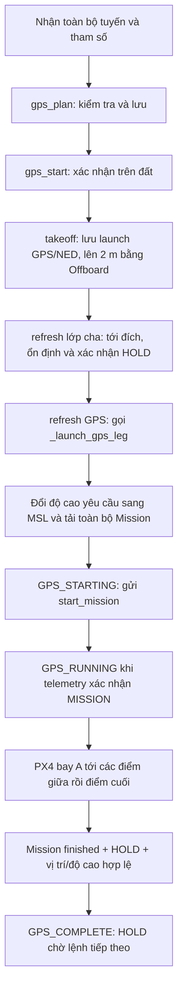

# Đọc flow của gps_mission.py

Mã chính: [`gps_mission.py`](../pi/flight/gps_mission.py).
`GpsMissionControl` kế thừa `OffboardControl`: dùng lại ARM, TAKEOFF,
local NED, HOLD/LAND/DISARM, cache telemetry và các kiểm tra của lớp cha;
bổ sung lập kế hoạch và vận hành PX4 Mission theo tọa độ GPS.

## Mốc độ cao trước khi đọc flow

| Giá trị | Ý nghĩa trong dự án |
|---|---|
| `self.height` | Độ cao TAKEOFF, lấy từ `--height`, mặc định 2 m |
| `launch_ned.down_m` | Tọa độ Z local của PX4 được chụp ngay trước TAKEOFF |
| `height_above_launch_m` | Độ cao ước lượng hiện tại: `z_launch - z_current` |
| `gps_plan_data.height_above_launch_m` | Độ cao **được yêu cầu** cho tuyến GPS, từ web/terminal |
| `position.absolute_altitude_m` | Độ cao tuyệt đối MSL ước lượng bởi PX4 |
| `position.relative_altitude_m` / gateway `altitude_relative` | Độ cao so với Home hiện tại của PX4; web hiện đang dùng trường này |
| `altitude_agl` | Khoảng cách tới mặt đất bên dưới khi có nguồn đo hợp lệ |

Đặt TAKEOFF 2 m khi Z ban đầu bằng 5,231 m thì đích là Z=3,231 m.
Z không cần bằng 0 khi bắt đầu. Chiều dương NED hướng xuống.
Độ cao TAKEOFF và GPS là theo mặt phẳng tại chỗ cất cánh; không phải
cam kết luôn cách địa hình bên dưới 2/3 m khi bay qua dốc hoặc công trình.

Web hiện chưa được tích hợp helper mới: cột độ cao đang theo Home,
nên không dùng số đó để suy ra trực tiếp độ cao local của controller.
Hướng sửa và phân biệt số đo/độ cao đặt: [LOGGING.md](LOGGING.md).

## Đường lệnh vào

```text
Web MQTT → control/protocol.py → ControlRouter → Unix IPC
    → FlightCommandRouter.handle() → gps_plan(...) → gps_start()

Terminal gps-plan → chỉ gps_plan(...)
Terminal gps-start → gps_start() dùng kế hoạch đã lưu
```

Web A→B→C→D→E→F được giải mã thành start=A, intermediates=[B,C,D,E],
end=F. `params['b']` trong IPC vẫn đặt tên theo giao thức hai điểm cũ;
khi có nhiều điểm, đây là **điểm cuối F**, không phải điểm B trên giao diện.
`gps_plan_data.waypoints` giữ danh sách đầy đủ theo thứ tự.

## Chu trình từ mặt đất



### 1. gps_plan: kiểm tra trước khi triển khai

- Chấp nhận trên đất ở IDLE hoặc ARMED; trên không phải hoàn tất TAKEOFF
  và ở HOLD/GPS_CANCELLED/GPS_COMPLETE/HOME_COMPLETE, PX4 HOLD và IN_AIR.
- Kiểm tra kết nối, health, telemetry, vĩ/kinh độ hữu hạn và độ cao/tốc độ.
- Độ cao nằm từ `self.height` tới `gps_limits.max_height_m`. Tốc độ nằm
  từ 0,1 tới `min(gps_limits.max_speed_m_s, px4_xy_vel_max)`.
- Tạo start → các điểm giữa → end, tối đa 50 điểm. Từ chối tuyến có mọi
  điểm nằm trong xy_tolerance quanh điểm đầu (mặc định 0,5 m).
- Tính khoảng tiếp cận và từng chặng; `--gps-max-leg` nếu có áp dụng cho
  cả tiếp cận và mọi chặng. Mặc định không có giới hạn quãng đường này.
- Lưu `origin_lat/origin_lon` là vị trí UAV hiện tại và `start_in_air`.
  Chưa ARM hoặc tải Mission của kế hoạch vừa lập.

`distance_m()` tính khoảng cách phục vụ kiểm tra/giám sát; không sinh
PID hay quỹ đạo điều khiển motor trên Pi.

### 2. gps_start: chọn nhánh đất hoặc trên không

Trên đất, kiểm tra UAV chưa rời origin quá 5 m rồi bật `gps_deploying`
và gọi `takeoff()`. Cờ này ngăn takeoff độc lập xóa kế hoạch GPS đang
triển khai. Khi đã vào TAKEOFF, đặt `gps_launch_pending=true`.

`takeoff()` trong lớp này chụp GPS điểm cất cánh cho return-home và gọi
`super().takeoff()` để chụp local NED, tạo đích `z_launch-self.height`,
chuẩn bị luồng Offboard, ARM nếu cần rồi chuyển Offboard. ACK/start mode
chưa phải xác nhận đã lên đủ 2 m.

Nếu lập kế hoạch khi đang HOLD trên không, gps_start bỏ qua TAKEOFF
và gọi `_launch_gps_leg()` trực tiếp; mốc launch của chuyến cũ được giữ.

### 3. refresh: nối TAKEOFF sang Mission

Flight Service gọi refresh đều đặn. Đầu hàm là `super().refresh()` để
lớp cha xử lý tới đích TAKEOFF và chuyển HOLD. Chỉ khi
`takeoff_complete=true`, phase HOLD và `hold_reason=TARGET_REACHED`,
nhánh `gps_launch_pending` mới gọi `_launch_gps_leg()`.
TAKEOFF bị LAND/đổi mode/lỗi thì bỏ cờ chờ; không triển khai tuyến GPS.

### 4. _absolute_target_altitude: đổi độ cao cho waypoint

```text
h_current = launch_ned.down_m - local_ned.down_m
target_MSL = current_MSL + requested_height - h_current
```

Dòng đầu tính độ cao hiện tại theo launch; dòng thứ hai cộng phần còn
cần lên/xuống vào độ cao tuyệt đối hiện tại. Global/local phải mới và
thời gian hai mẫu cách nhau không quá `sample_gap_s` (mặc định 0,6 s).

Ví dụ đang ở 2 m trên launch, current_MSL=102 m, nhiệm vụ yêu cầu 3 m:
đích mọi waypoint là 103 m MSL. Không gửi số 3 như thể đó là MSL và không
lấy Home PX4 làm mốc của waypoint. Đích MSL đã tải được giữ cố định trong
Mission; thay đổi Home không tự dịch nó. Estimator local/global vẫn có
thể trôi; thuật toán này không loại bỏ mọi sai số cảm biến.

### 5. _launch_gps_leg: tạo và chạy Mission

Xác nhận HOLD/IN_AIR, kiểm tra lại origin rồi tạo:

```text
Item 0: DO_CHANGE_SPEED, tốc độ ngang đã chọn
Item 1: NAV_WAYPOINT A, độ cao MSL đã tính
Item 2: NAV_WAYPOINT B, cùng độ cao
…
Item cuối: NAV_WAYPOINT F, cùng độ cao, thời gian chờ 1 s
```

`_speed_item()` đặt loại tốc độ ground speed. `_mission_item()` dùng
`MAV_FRAME_GLOBAL_INT`, tọa độ lat/lon nhân 10^7, z tính bằng mét MSL.
Mọi waypoint hiện dùng cùng độ cao và tốc độ; chưa có cấu hình riêng
từng waypoint. Điểm giữa có thời gian chờ 0 và autocontinue=1.

Tải một danh sách MissionRaw lên PX4, chờ 1 s để Commander cập nhật,
kiểm tra HOLD và đặt mục hiện tại về 0 qua `_confirm_new_mission_ready()`.
Sau đó bỏ luồng Offboard cũ, ghi epoch, đặt GPS_STARTING và start_mission.
Chỉ telemetry MISSION mới sau epoch mới chuyển phase sang GPS_RUNNING.

Nếu nhiệm vụ chọn 3 m, sau TAKEOFF/HOLD 2 m, đích A là 3 m. Code **không
có bước bắt buộc lên đủ 3 m tại chỗ trước khi bay ngang tới A**. PX4 có
thể vừa đổi độ cao vừa tiếp cận A. Nếu cần tách hai chuyển động, đó là
một thay đổi thuật toán khác.

### 6. Chặng giữa và xác nhận điểm cuối

PX4 tự dẫn đường, chấp nhận waypoint theo cấu hình của nó và chuyển
sang mục kế tiếp. Pi không gửi từng đích lại mỗi giây và không tự phát
lệnh motor. Không có yêu cầu HOLD riêng tại mọi điểm giữa.

Khi `is_mission_finished()` đúng mà mode còn MISSION, Pi yêu cầu HOLD.
Khi mode HOLD, `_gps_target_height_confirmed()` kiểm tra vị trí/độ cao
mới sau thời điểm HOLD. Bán kính điểm cuối là
`min(2 m, max(xy_tolerance_m, 0.25 × độ dài chặng cuối))`;
sai số độ cao cho phép là `z_tolerance_m` (mặc định 0,3 m).
Chỉ đủ cả Mission finished, HOLD và kiểm tra cuối mới báo GPS_COMPLETE.
Nếu đợi hết confirmation_s (mặc định 5 s) mà chưa xác nhận thì báo
GPS_UNCONFIRMED, không coi ACK là hoàn thành chuyến bay.

## Lệnh trong khi bay

| Lệnh/hàm | Chuỗi thực hiện |
|---|---|
| pause / gps_pause | Chỉ khi GPS_RUNNING; pause_mission → GPS_PAUSE_REQUESTED → telemetry HOLD mới → GPS_PAUSED |
| resume / gps_resume | Chỉ GPS_PAUSED và Mission vẫn lưu; start_mission tiếp Mission cũ → telemetry MISSION mới → GPS_RUNNING |
| cancel / gps_cancel | Yêu cầu HOLD; chờ mode/vị trí mới; clear_mission; bỏ kế hoạch → GPS_CANCELLED; nhận tuyến mới từ HOLD |
| return_home | Sau cancel/hoàn tất; GPS_PAUSED có thể tự cancel trước. Lập Mission mới về launch_gps ở độ cao local hiện tại; HOLD cuối, không tự LAND |
| return_height | Chuyển HOLD đã hoàn tất/hủy về local Offboard, giữ x/y hiện tại và về `self.height` |
| land | Xóa ý định GPS/cờ chờ rồi gọi LAND lớp cha |
| disarm | Xóa ý định GPS rồi gọi force motor stop lớp cha; không dùng để hạ cánh bình thường |

Return Home có deadline theo khoảng cách/tốc độ; Mission tuyến GPS không
dùng deadline local NED 60 s làm hạn cho toàn tuyến. `confirmation_s` là
thời gian chờ xác nhận chuyển mode/hoàn tất, không phải tổng thời gian bay.
Mất link hoặc đổi mode ngoài dự kiến vào EXTERNAL, không tự resume.
`status()` tổng hợp phase, kế hoạch, launch, giới hạn, tiến độ và quyền nhận đích;
`close()` giải phóng Mission rồi đóng lớp cha.

Các trạng thái `GPS_*` là FSM của Pi. PX4 vẫn báo các mode như OFFBOARD,
MISSION, HOLD, LAND; hai loại trạng thái này không phải một.

## Thứ tự đọc mã để tự theo dõi

Đọc `gps_plan` → `gps_start` → `takeoff` (và lớp cha) → `refresh` phần
`gps_launch_pending` → `_launch_gps_leg` → `_absolute_target_altitude`,
`_speed_item`, `_mission_item` → `refresh` phần GPS_RUNNING →
`_gps_target_height_confirmed`. Sau đó đọc pause/resume/cancel và return.
Trong `status`, quan sát `phase`, `telemetry.flight_mode`,
`height_above_launch_m`, `gps_mission.plan`, `last_error` để theo flow.

## Theo dõi tiến độ và log hiện tại

Flight Service nhận MissionRaw progress để hiển thị waypoint mục tiêu;
MISSION_ITEM_REACHED được ghi riêng khi PX4 báo đã đạt một item hợp lệ.
Item 0 là lệnh tốc độ, item 1..N là các waypoint. Các thông tin này chỉ
phục vụ hiển thị/log, không thay điều kiện GPS_COMPLETE của FSM.
Log và dữ liệu status mới ở [LOGGING.md](LOGGING.md).

## Giao thức nhiệm vụ và các nút web

### Payload web hiện tại

Nhiệm vụ hai điểm gửi sáu trường cùng trong **một** bản tin tới
`lac/<deviceID>/control` khi bấm “Gửi nhiệm vụ & cất cánh”:

```text
c:spd:0.5;c:height:3;c:startlat:47.3977760;c:startlong:8.5456050;c:endlat:47.3978100;c:endlong:8.5456500;
```

`startlat/startlong` là điểm A, `endlat/endlong` là điểm B. `height` là
độ cao so với mốc cất cánh; `spd` là m/s. Control service nhận đủ các
trường của nhiệm vụ trong một payload và Retain OFF. Nó chuyển thành một lệnh `gps_start`: kiểm tra kế
hoạch bằng `gps_plan`, rồi gọi `gps_start`. Từ đất, PX4 TAKEOFF/HOLD trước
khi bay A→B; từ HOLD trên không, nó bắt đầu chặng A→B theo điều kiện của
FSM hiện tại. Kết thúc tại B là HOLD trên không, không tự LAND.

#### Ba điểm trở lên

Web bổ sung `wpcount:N` và các cặp `wp1lat/wp1long` đến
`wpNlat/wpNlong` giữa điểm đầu và điểm cuối. `wpcount` là **số điểm trung
gian**, không tính start/end. Ví dụ bốn điểm (tọa độ minh họa định dạng):

```text
c:spd:0.5;c:height:3;c:startlat:21.0285110;c:startlong:105.8544440;c:wpcount:2;c:wp1lat:21.0450000;c:wp1long:105.8800000;c:wp2lat:21.0532450;c:wp2long:105.8927780;c:endlat:21.0573670;c:endlong:105.8991670;
```

Thứ tự bay là start → wp1 → wp2 → end, tương ứng A → B → C → D trên web.
Với ba điểm, dùng `wpcount:1` và chỉ có cặp `wp1`. Không có `wpcount`
thì vẫn nhận sáu trường hai điểm như trước; `wpcount:0` cũng hợp lệ.
Phải có đủ cặp tọa độ liên tiếp từ 1 đến N, không thiếu/thừa/trùng trường.
Giới hạn cấu trúc hiện tại là 50 điểm tổng cộng (48 điểm trung gian),
payload không quá 64 KiB. Mọi tọa độ phải hữu hạn và trong miền vĩ/kinh độ.

Pi kiểm tra toàn bộ tuyến trước khi TAKEOFF hoặc tải mission; PX4 nhận
một MissionRaw chứa lệnh tốc độ rồi tất cả waypoint theo thứ tự, cùng độ
cao đã chọn. Các điểm giữa không yêu cầu HOLD riêng; đến điểm cuối thì HOLD.
Pause/resume tiếp tục mission đang lưu trên PX4, không tải lại từ điểm đầu.
Cancel bỏ mission, HOLD tại chỗ và cho phép lập tuyến mới. LAND và DISARM
cục bộ giữ hành vi hiện có. Chỉ báo GPS_COMPLETE khi PX4 báo mission
finished, ở HOLD và telemetry mới xác nhận vị trí cuối cùng/độ cao.

Status `gps_mission.plan` có `waypoints`, `waypoint_count`,
`leg_distances_m`, `route_distance_m` (từ start tới end, không tính tiếp
cận), `approach_m` và `leg_m` (chặng cuối để tính bán kính xác nhận).
Nhiệm vụ phải có di chuyển ngang: nếu mọi điểm đều nằm trong
`xy_tolerance_m` (mặc định 0,5 m) quanh điểm đầu thì từ chối toàn bộ
trước TAKEOFF/upload. Start=end nhưng có điểm trung gian khác vẫn là tuyến
bay qua các điểm rồi quay về điểm cuối.

Lệnh terminal `gps-plan` vẫn nhận hai điểm; nhiệm vụ nhiều điểm đi qua web/MQTT.
Miền parser tốc độ là 0–20 m/s; Flight Service yêu cầu tối thiểu 0,1
và áp dụng trần cấu hình. Độ cao vượt `--gps-max-height` bị từ chối.
Giới hạn vận hành còn phụ thuộc `--gps-max-speed` và `MPC_XY_VEL_MAX`.
Phần nhiều điểm mới được kiểm thử phần mềm với mock/IPC; chưa thử HITL/bay thật.

Payload `control` không có `command_id` hoặc hạn dùng do backend cấp.
Pi tạo ID riêng cho mỗi bản tin nhận được, nên có thể gửi lại cùng một
nhiệm vụ sau khi nhiệm vụ trước hoàn tất. Retain phải OFF; giao thức hiện
không có cơ chế chống phát lại bản tin cũ do backend gửi lại.

Các nút web dùng **cùng topic** `lac/<deviceID>/control`, mỗi lần bấm gửi
một payload riêng: `d:arm` → ARM trên đất; `d:takeoff` → cất cánh tại chỗ;
`d:pause` → tạm dừng; `d:resume` → tiếp tục;
`d:abort` → hủy đích hiện tại và HOLD tại chỗ; `d:rtl` → trở về GPS
điểm cất cánh ở độ cao hiện tại rồi HOLD; `d:land` → yêu cầu PX4 LAND.
Không dùng Retain. `d:rtl` yêu cầu nhiệm vụ đang chạy đã hoàn tất hoặc đã
`d:abort` và PX4 xác nhận HOLD; khi GPS đang PAUSED, lệnh này tự hủy
nhiệm vụ cũ rồi kiểm tra HOLD. `d:abort` trong TAKEOFF bị từ chối vì chưa
có chặng GPS để hủy;
`d:land` vẫn là lệnh hạ cánh ưu tiên. Các lệnh chỉ được nhận theo phase và
telemetry hiện hành, không bảo đảm hoàn thành chỉ nhờ ACK MQTT/IPC.

`d:arm` không gửi đích bay lên. `d:takeoff` dùng `--height` của Flight
Service (mặc định 2 m), không dùng `c:height` của nhiệm vụ GPS và không nhận
tham số kèm nút. Nó có thể bắt đầu từ IDLE/disarmed hoặc ARMED đã xác nhận
trong phiên; sau khi tới độ cao thì HOLD. Cả hai giữ nguyên kiểm tra
`--enable-actuation`, kết nối, telemetry mới, ON_GROUND và preflight.
Nút takeoff ghi “2 m” trên web chỉ đúng khi service chạy `--height 2`.
ARM/TAKEOFF qua web được kiểm thử phần mềm với mock và IPC; chưa được
thử trên HITL hoặc UAV thật với bản bổ sung này.
