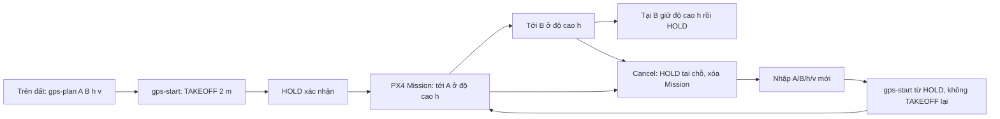

# Nhiệm vụ GPS A→B trên Pi — chờ nối MQTT/web

Tài liệu này chốt ý nghĩa các nút trong giao diện web do người vận hành
cung cấp ngày 28/10/2026 và bảng
[UAV_POC_Project — 2. MQTT Protocol](https://docs.google.com/spreadsheets/d/1hOhhjXzGSBFfmBoMa3Te5p6idgDC99oieI7ZTjRQYHo/edit?gid=1886809361#gid=1886809361).
Pi đã có các lệnh GPS qua terminal trong `controller/pi/gps_mission.py` và
`controller/pi/console.py`. Đây là **mã nguồn đã kiểm tra bằng unit test với
mock**, chưa có adapter MQTT/web và chưa được kiểm chứng trên Pixhawk/HITL
hay bay thật. Lệnh local `fly x y` vẫn là mét theo NED; không gửi vĩ độ/
kinh độ vào lệnh đó.

## Giao thức MQTT hiện có trong bảng

| Hướng | Topic/payload được ghi trong bảng |
|---|---|
| Pi đăng dữ liệu | `lac/<deviceID>/data`; một dòng `timestamp[tab]parameter:value...` |
| Pi nhận điều khiển | `lac/<deviceID>/control` |
| Pi đăng chẩn đoán | `lac/<deviceID>/debug` |

Bảng ghi broker cổng `8883`, nhưng chưa định nghĩa chứng chỉ CA, chính sách
TLS, QoS, retain, xác thực lệnh, `deviceID` thực tế hoặc cách nhận ACK. Mật
khẩu phải được cấp qua cấu hình bí mật trên Pi, không đưa vào repository
hoặc log. Bảng hiện liệt kê đúng sáu lệnh server → device dưới đây; `x` và
`z` là chỗ đặt giá trị, không phải ký tự gửi nguyên xi:

| Lệnh trong bảng | Ý nghĩa cần chốt khi tích hợp |
|---|---|
| `c:spd:x;` | Tốc độ m/s; bảng ghi 0–10, nhưng giới hạn thực tế còn phụ thuộc PX4 và thử bay |
| `c:height:z;` | Độ cao mét; cần chốt mốc là so với home/takeoff, MSL hay AGL |
| `c:startlat:x;`, `c:startlong:x;` | Vĩ độ/kinh độ waypoint A; UAV bay tới A trước B |
| `c:endlat:x;`, `c:endlong:x;` | Vĩ độ/kinh độ B, waypoint đích |

Sáu lệnh này **chưa có lệnh bắt đầu, pause, resume, cancel, LAND hoặc return-home**.
Chúng cũng được gửi riêng lẻ, nên Pi không thể biết bộ sáu giá trị đã đầy
đủ hay cùng một phiên bản nhiệm vụ. Không tự khởi hành ngay khi nhận
`endlong`. Cần backend định nghĩa thêm `mission_id`/phiên bản, lệnh xác
nhận hoàn tất bộ tham số và các lệnh điều khiển cùng ACK/trạng thái lỗi.
Lệnh cũ sau khi Pi khởi động lại không được chạy lại: topic điều khiển
không nên `retain`; cần ID/sequence để lọc bản tin lặp hoặc trễ.

MQTT web ↔ Pi là đường ra lệnh nhiệm vụ. UDP `127.0.0.1:14540` trên Pi là
đường MAVLink Router ↔ MAVSDK ↔ Pixhawk; UDP tới QGC trên PC là đường
giám sát. Không gửi chuỗi `c:...;` thẳng vào cổng MAVLink.

## Lệnh thử qua terminal trên Pi

Chạy console với profile, đường MAVLink và `--enable-actuation` như trong
README. Khi UAV còn `IDLE`, `armed=false`, `ON_GROUND`, xem
`status.telemetry.position`, chọn hai waypoint A và B gần vị trí hiện tại.
Không cần
gõ `takeoff` riêng cho nhiệm vụ GPS:

```text
gps-plan <A_lat> <A_lon> <B_lat> <B_lon> <height_m> <speed_m_s>
gps-start
pause
resume
cancel
return-home
return-height
land
```



Các mũi tên Cancel biểu diễn yêu cầu điều khiển; Pi chỉ báo thành công sau
khi PX4 xác nhận HOLD, có GPS mới và xóa được Mission cũ.

## Nút web và lệnh Pi tương ứng

Đây là **bảng ánh xạ để tích hợp sau**, chưa phải các nút web đã điều khiển
được Pi. Backend hiện chưa có adapter gửi lệnh vào phiên controller này.

| Nút web | Hàm/lệnh của phiên Pi | Kết quả cần chờ |
|---|---|---|
| Xác nhận và triển khai A/B | `gps_plan(A, B, height, speed)` rồi `gps_start()` | TAKEOFF/HOLD, sau đó `GPS_RUNNING` |
| Tạm dừng | `pause()` | `GPS_PAUSED`, PX4 HOLD |
| Tiếp tục | `resume()` | `GPS_RUNNING`, PX4 MISSION |
| Hủy nhiệm vụ | `cancel()` | `GPS_CANCELLED`, PX4 HOLD tại chỗ; có thể nhập A/B mới |
| Hạ cánh ngay | `land()` | PX4 LAND, sau đó `ON_GROUND` và disarmed |
| Về điểm cất cánh | `return_home()` | Bay về GPS chụp lúc TAKEOFF ở độ cao hiện tại, rồi HOLD; LAND riêng |
| Về độ cao cất cánh | `return_height()` | Giữ x/y hiện tại, về `--height` (mặc định 2 m), rồi HOLD |

Nếu nút “Cất cánh” trên web chỉ yêu cầu lên cao tại chỗ, nó ánh xạ tới
`takeoff()`; nút “Triển khai nhiệm vụ” mới gọi `gps_start()`. Không gọi cả
hai cho cùng một nhiệm vụ GPS từ mặt đất, vì `gps_start()` đã tự TAKEOFF.
`disarm` là lệnh dừng motor cưỡng bức riêng, không dùng thay nút hạ cánh.

`return-home` là Mission một waypoint do Pi tạo, **không gọi PX4 RTL**.
Pi chụp GPS điểm cất cánh lúc TAKEOFF. Nếu đang có đích FLY hoặc GPS Mission,
phải `cancel` và chờ HOLD xác nhận trước. Sau đó Pi upload waypoint về vị
trí cất cánh tại độ cao lúc bấm lệnh.
Sau khi PX4 báo Mission hoàn tất, Pi yêu cầu HOLD nếu PX4 còn ở mode MISSION;
khi HOLD được xác nhận, Pi kiểm tra GPS trong 2 m và
độ cao estimator trong `z_tolerance_m` trước khi báo `HOME_COMPLETE`.
Vận tốc dùng từ kế hoạch hiện tại hoặc giới hạn `--gps-max-speed` khi không
có kế hoạch; giữ trong giới hạn `MPC_XY_VEL_MAX`. Chức năng chặn đích quá
`2 × --gps-max-leg + 5 m` và chặn nếu `MIS_TAKEOFF_ALT` sẽ ép leo cao.
Độ cao đo theo estimator, không phải độ cao thật so với mặt đất trên
toàn tuyến. `land`/`disarm` vẫn có thể can thiệp qua cùng phiên.
[MAVSDK Mission API](https://mavsdk.mavlink.io/main/en/cpp/api_reference/classmavsdk_1_1_mission.html).

`pause`, `resume`, `cancel` tự chọn nhiệm vụ GPS khi đang ở pha `GPS_*`,
hoặc local NED khi đang FLY/SETTLING/PAUSED. Cú pháp terminal không có
`gps-pause`, `gps-resume`, `gps-cancel`. Tên lệnh giống nhau nhưng nhánh GPS
dùng PX4 Mission, còn nhánh NED dùng Offboard và đích local được lưu.

`gps-plan` chỉ lưu kế hoạch trên Pi khi UAV còn trên đất hoặc đang HOLD trên
không sau Cancel/hoàn thành nhiệm vụ; không ARM, không
upload. `gps-start` là lệnh triển khai tường minh: TAKEOFF tới độ cao
`--height` (mặc định 2 m), chờ PX4 xác nhận HOLD và `takeoff_complete=true`,
kiểm tra lại vị trí khởi hành, rồi upload/bắt đầu PX4 Mission A → B.
Nếu đã ở HOLD trên không sau Cancel, `gps-start` bắt đầu
Mission mới từ vị trí đó, không TAKEOFF lần hai. Nếu TAKEOFF lỗi, quá hạn,
bị LAND hoặc vị trí đã lệch xa vị trí lúc lập kế hoạch, Pi không gửi Mission.
Trường `gps_mission.waiting_for_takeoff_hold` trong `status` cho biết chuỗi
đang chờ TAKEOFF hoàn tất.
`pause` trong GPS yêu cầu PX4 HOLD ở vị trí/độ cao hiện tại; sau khi mode HOLD
được xác nhận, `resume` tiếp tục cùng nhiệm vụ. `cancel` trong GPS yêu cầu
HOLD tại vị trí/độ cao hiện tại, đợi mẫu GPS mới sau HOLD rồi xóa Mission
cũ. Pi khóa Resume và cho lập A/B/độ cao/tốc độ mới. Nếu HOLD hoặc xóa
Mission không xác nhận, Pi báo `GPS_UNCONFIRMED` và không nhận nhiệm vụ mới.
Sau `GPS_CANCELLED`, có thể dùng `fly x y` ở độ cao đang HOLD hoặc nhập A/B
mới. `return-home` chỉ nhận khi đích cũ đã Cancel hoặc hoàn tất.
Sau Cancel, `status.gps_mission.last_cancel_position` là GPS mới lúc HOLD;
`gps_mission.plan` của nhiệm vụ kế tiếp chứa A/B mới cùng `origin_lat/lon`
(vị trí lúc lập kế hoạch). `gps-start` vẫn cần được gõ sau `gps-plan`.

Mặc định TAKEOFF là 2 m (`--height 2`), GPS Mission giới hạn mỗi chặng
vị trí hiện tại→A và A→B trong 0,5–10 m, độ cao bay từ 2 đến 3 m,
tốc độ tối đa 0,5 m/s. UAV không được di chuyển quá 5 m so với vị trí
lúc lập kế hoạch trước khi triển khai. Giới hạn tốc độ còn bị chặn theo `MPC_XY_VEL_MAX` đọc từ
Pixhawk. Có thể đặt lại giới hạn Pi bằng `--gps-max-leg`,
`--gps-max-height`, `--gps-max-speed` sau khi đã kiểm chứng an toàn trên
thiết bị; cờ CLI **không** thay tham số PX4. `height_m` và `speed_m_s`
được chọn riêng cho từng `gps-plan`, không phải tốc độ/độ cao cố định của
phần mềm.
Trước upload, Pi đọc `MIS_TAKEOFF_ALT` và từ chối kế hoạch có độ cao bay
thấp hơn mốc này để PX4 không tự thêm một pha leo cao ngoài yêu cầu.

## Dữ liệu và mốc độ cao

- A và B là **hai waypoint khác nhau**. Pi ghi vị trí GPS hiện tại từ
  Pixhawk làm mốc kiểm tra khi lập kế hoạch; mốc đó không thay thế A.
  PX4 bay tới A trước, sau đó tới B.
- B là waypoint GPS cuối. Pi gửi A/B cho PX4 dưới dạng nhiệm vụ toàn cục;
  PX4 làm định vị, dẫn đường và điều khiển. Không lấy GPS rồi tự cộng độ
  dời vào `fly x y` của console hiện tại.
- Pi diễn giải `height_m` thành độ cao **so với mốc TAKEOFF**. MAVSDK
  MissionItem dùng độ cao so với PX4 Home, nên Pi tính lại mốc này từ
  `relative_altitude_m` và local NED mới trước khi upload. Đây vẫn là
  độ cao **ước lượng**; không phải khoảng cách AGL trên toàn tuyến.
- Sau TAKEOFF/HOLD, PX4 nhận hai waypoint: A rồi B, đều ở độ cao bay đã
  chọn. Tại B giữ độ cao đó. `speed_m_s` đặt trong từng
  MissionItem; giới hạn tốc độ lên/xuống còn do PX4 quyết định. PX4
  kiểm soát điều hướng, Pi không chạy PID.
- Khi PX4 hoàn tất waypoint cuối, Pi yêu cầu HOLD nếu PX4 còn ở MISSION.
  Sau khi HOLD được xác nhận, Pi còn kiểm tra GPS gần B trong 2 m và độ cao
  ước lượng so với độ cao đã chọn trong `z_tolerance_m` trước khi báo
  `GPS_COMPLETE`. Không tự return-home/LAND.
  [PX4 Mission mode](https://docs.px4.io/v1.17/en/flight_modes_mc/mission).

## Trạng thái và lệnh

| Trạng thái Pi | Điều kiện PX4 cần xác nhận | Lệnh Pi có thể nhận sau khi nối web |
|---|---|---|
| `IDLE`/`ARMED` trên đất | GPS và health mới, ON_GROUND | `gps-plan`; sau khi có kế hoạch thì `gps-start` |
| `TAKEOFF`/`HOLD_REQUESTED` | `gps-start` đã yêu cầu cất cánh; chưa tới đích hoặc chờ HOLD | LAND/DISARM; return-home cần TAKEOFF hoàn tất |
| `HOLD` sau TAKEOFF | Độ cao TAKEOFF hoàn tất, PX4 HOLD, vị trí khởi hành còn gần mốc lập kế hoạch | Pi tự upload và start Mission A→B |
| `GPS_STARTING` → `GPS_RUNNING` | Mode MISSION mới được xác nhận | Pause, Cancel, LAND/DISARM; Cancel trước return-home |
| `GPS_PAUSE_REQUESTED` → `GPS_PAUSED` | Mode HOLD mới được xác nhận | Resume, Cancel, LAND/DISARM |
| `GPS_RESUME_REQUESTED` → `GPS_RUNNING` | Mode MISSION mới được xác nhận | Pause, Cancel, LAND/DISARM |
| `GPS_CANCEL_REQUESTED` → `GPS_CANCELLED` | HOLD tại chỗ, GPS mới sau HOLD, Mission cũ đã xóa | `fly x y`, lập A/B mới, return-home, return-height, LAND/DISARM |
| `GPS_COMPLETE` | Mission đã kết thúc tại B, HOLD và độ cao đã chọn được xác nhận | Lập nhiệm vụ mới, return-height, return-home, LAND/DISARM |
| `GPS_UNCONFIRMED`, `EXTERNAL` | ACK/mode/độ cao không xác nhận hoặc đổi mode ngoài ý muốn | Kiểm tra status, LAND/DISARM; không tự Resume |
| `HOME_HOLD_REQUESTED` → `GPS_RUNNING` → `HOME_COMPLETE` | HOLD, waypoint cất cánh, PX4 về và HOLD | Pause/Resume/Cancel khi đang bay về; LAND/DISARM bất cứ lúc nào qua phiên |

Pause gọi `Mission.pause_mission()`; Resume gọi `Mission.start_mission()`
trên nhiệm vụ đang lưu. Cancel chuyển HOLD tại chỗ và xóa Mission cũ.
Chặng A→B chỉ được xác nhận hoàn tất bằng
`is_mission_finished`, mode HOLD, GPS gần B và local NED mới trong ngưỡng. ACK đơn lẻ
chưa đủ. Cancel **không hạ cánh, không hạ về 2 m và không tắt motor**.
LAND/DISARM vẫn là lệnh khác.
[MAVSDK Mission API](https://mavsdk.mavlink.io/main/en/cpp/api_reference/classmavsdk_1_1_mission.html),
[PX4 Hold](https://docs.px4.io/v1.17/en/flight_modes_mc/hold).

MQTT adapter tương lai cần `mission_id` và `command_id` duy nhất, xử lý
tuần tự, từ chối lệnh lặp/cũ và xác nhận trạng thái PX4. Console hiện
chỉ có một kế hoạch GPS đang hoạt động tại một thời điểm, chưa có ID/khử lặp bản tin.
Sau mất kết nối hoặc PX4 đổi mode, không tự Resume. API cụ thể sẽ ghép
khi có mã backend web.
Không chạy console local NED và dịch vụ web cùng chiếm UDP 14540.

## Hạ cánh khi web chưa có nút LAND

Khi đang điều khiển bằng console trên Pi, gõ `land` **ngay trong terminal
đang chạy console đó**. Lệnh đi tới PX4 dù đang TAKEOFF, GPS Mission,
PAUSED hoặc GPS_CANCELLED; sau đó dùng `status` kiểm tra mode LAND,
`ON_GROUND` và `armed=false`. Không dùng `cancel` thay LAND: Cancel chỉ
đưa UAV về HOLD tại vị trí và độ cao hiện tại, motor vẫn có thể quay.

Sau này nếu dịch vụ web nắm phiên MAVLink UDP `127.0.0.1:14540`, không mở
console thứ hai cùng cổng để gõ `land`. Backend cần chuyển nút LAND vào
**chính phiên Pi đang điều khiển**; QGC qua router hoặc RC độc lập là
đường can thiệp khác nếu đã cấu hình và kiểm chứng. Khi Pi mất nguồn/kết
nối, không thể trông chờ lệnh terminal trên Pi; hành vi còn lại do
failsafe PX4 quyết định.

## Điều kiện chặn trước khi gửi nhiệm vụ

1. Cần GPS/global position hợp lệ, telemetry mới, PX4 đang HOLD trước
   khi gửi Mission. Khi lập kế hoạch trên đất, Pi TAKEOFF trước. Khi
   lập kế hoạch sau Cancel trong HOLD, Pi đi thẳng tới A. Pi kiểm tra
   lại mốc GPS khi triển khai và giới hạn hai chặng hiện tại→A, A→B.
2. Kiểm tra B, chiều dài chặng, độ cao và tốc độ theo giới hạn **đã được
   xác thực trên UAV thật**. Ví dụ trên ảnh: A→B khoảng 3,22 km, cao
   90 m, tốc độ 15 m/s. Tốc độ này vượt cả giới hạn 0–10 m/s trong bảng
   lệnh. Bộ tham số hiện tại đặt `MPC_XY_VEL_MAX=0,5 m/s`
   và phần mềm mới kiểm chứng công thức TAKEOFF 2 m; do đó không nhận
   nguyên ví dụ đó làm chuyến bay thử.
3. Kiểm tra đường bay, chướng ngại, pin, gió, geofence và đường điều
   khiển dự phòng độc lập với Pi. Mission đã upload có thể tiếp tục trên
   Pixhawk nếu web/Pi mất; QGC hiện cũng đi qua Pi/router. Cần cấu hình
   và thử hành động mất liên kết trước khi bay xa.
4. Nếu `EKF2_HGT_REF` được đổi sang baro, xác nhận lại bản tham số xuất
   từ QGC, reboot Pixhawk, quan sát độ cao EKF khi UAV đứng yên và so với
   nguồn đo độc lập. Baro không bảo đảm giữ đúng 90 m so với địa hình;
   lidar/rangefinder chỉ có ích trong phạm vi đo hợp lệ và trên bề mặt
   phù hợp. [PX4 EKF2 height](https://docs.px4.io/v1.17/en/advanced_config/tuning_the_ecl_ekf).

## Cần xác nhận với backend web

- Broker cổng 8883 có bắt buộc TLS không, CA và cách cấp bí mật cho Pi;
  `deviceID`, QoS, retain, ACK và cách server gắn lệnh với một UAV.
- Tên/định dạng lệnh bắt đầu, tạm dừng, tiếp tục, hủy, LAND/return-home; một ID
  nhiệm vụ và ID lệnh cho mỗi lần gửi. Bảng hiện chưa có các lệnh này.
- Mốc độ cao của `c:height:z;`, cách truyền đầy đủ sáu trường như một
  nhiệm vụ duy nhất, và cách web hiển thị lỗi/telemetry xác nhận.
- Giới hạn chiều dài chặng/độ cao/tốc độ thực tế sẽ được phép sau các
  bài bay gần trên UAV thật.
