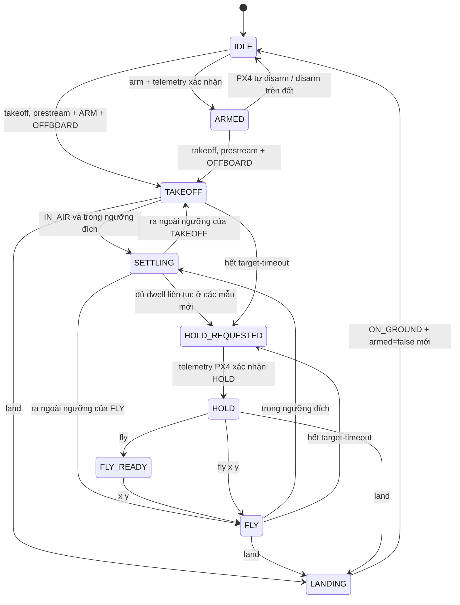

# Luồng điều khiển local NED và cách kiểm chứng

Kỹ thuật dùng ở đây là **finite-state machine (FSM)** cho tuần tự lệnh,
kèm **waypoint acceptance + dwell** để giám sát đích. PX4 vẫn chạy mọi vòng
điều khiển vị trí/vận tốc/attitude/rate. Pi chỉ kiểm tra điều kiện chuyển
trạng thái từ telemetry, không tạo PID hoặc setpoint vận tốc.

Code nằm trong `controller/pi/`; test Pi ở `controller/tests/`.
`pixhawk.py` chỉ giữ kết nối/telemetry; mọi lệnh bay đi qua FSM trong
`offboard_control.py`. `validation.py` kiểm tra giá trị số dùng chung.
README gốc mô tả kiến trúc và lệnh nhanh; tài liệu này giữ bảng điều kiện,
FSM, ngưỡng và quy trình xác nhận chi tiết. Offboard chuẩn không có ACK
hoàn thành waypoint, nên `target_reached` là kết quả giám sát Pi.

## Các trạng thái



Sơ đồ rút gọn: STARTING, ARM_REQUESTED, LAND_REQUESTED, DISARM_REQUESTED
là trạng thái chờ ACK/xác nhận. Từ mọi trạng thái được cấp quyền, LAND và
DISARM được xử lý trước khóa đích; flight termination/mất kết nối có thể
khiến Pixhawk không thực hiện được lệnh. Console chờ RPC native theo từng lệnh, nên ưu tiên này không phải nút
khẩn cấp thời gian thực khi RPC khác đang chờ. Không có hàng đợi tọa độ: lệnh
khi đang bận bị từ chối rõ ràng, không lén chạy sau đó.

| Lệnh | Điều kiện / hành vi |
|---|---|
| `arm` | IDLE, disarmed, ON_GROUND, preflight tốt; không phát Offboard |
| `takeoff` | IDLE/disarmed hoặc ARMED trong phiên; lên `z_launch-height` |
| `fly` | Chọn nhập tọa độ từ HOLD sau TAKEOFF hoàn tất; PX4 vẫn HOLD |
| `x y` | Chỉ nhận ở FLY_READY, đơn vị mét Bắc/Đông tuyệt đối theo EKF |
| `fly x y` | Lệnh tường minh rời HOLD để bay tới đích mới |
| `land` | Cùng MAV_CMD_NAV_LAND từ ARM trên đất hoặc lúc bay; theo dõi riêng ACK và mode |
| `disarm` | Một lệnh dừng motor cưỡng bức cả trên đất và trên không, gọi API `Action.kill()` nội bộ |

HOLD là tự động. DISARM trên không có thể làm UAV rơi; LAND là hạ cánh có điều khiển. Không chờ khóa đích, health hay
telemetry mặt đất trước khi gửi DISARM; vẫn cần kết nối và quyền actuation.

HOLD không có đồng hồ tự mở khóa. Tọa độ trần bị khóa đến khi chọn FLY.
Nếu TAKEOFF hết deadline mà chưa hoàn tất, HOLD không mở FLY: dùng LAND
hoặc DISARM và bắt đầu lại từ trạng thái mặt đất đã xác nhận. Nếu FLY quá
hạn sau một TAKEOFF đã hoàn tất, người dùng có thể chọn FLY tường minh
để gửi đích mới từ HOLD; không tự tiếp tục đích quá hạn.

## Bước FLY: đặt đích và giới hạn kiểm chứng

Giữ quy ước x/y tuyệt đối theo gốc EKF. `fly 1 2` gửi north=1, east=2;
không cộng mốc cất cánh hoặc vị trí hiện tại vào hai số này. Z và yaw giữ
từ đích TAKEOFF, không trừ thêm height sau mỗi chặng. Vì vậy không có
phép cộng dồn đích x/y hoặc tính lại độ cao theo vị trí đang trôi.

Quy trình hiện tại:

1. Yêu cầu TAKEOFF đã hoàn tất, HOLD được xác nhận, còn kết nối, ARMED,
   IN_AIR, dữ liệu trạng thái mới và health đạt.
2. Kiểm tra đầu vào x/y hữu hạn trong ±10000 m; gửi một đích cố định,
   prestream và chờ xác nhận OFFBOARD. Không ARM lại khi bắt đầu FLY.
3. Khóa đích trong FLY/SETTLING/HOLD_REQUESTED; tọa độ mới bị từ chối,
   không xếp hàng. LAND/DISARM vẫn đi qua khóa đích.
4. Giám sát sai số ngang theo vector, z và yaw trên mẫu mới đủ dwell.
   Đi qua đích một lần rồi ra ngoài ngưỡng sẽ xóa dwell, không báo tới đích.
5. Yêu cầu native HOLD, chờ mode mới. Hết deadline yêu cầu HOLD với
   `target_reached=false`; không tự gửi lại hoặc tiếp tục đích quá hạn.

Đã bổ sung bốn test hồi quy dùng mock: nhiều chặng từ mốc ban đầu khác 0
không cộng dồn x/y/z; khóa tọa độ qua FLY/SETTLING/chờ HOLD; đi qua rồi
vượt khỏi vùng đích không hoàn thành dwell; timeout FLY không báo thành
công hoặc tự thử lại.

**Đúng đích gửi không đồng nghĩa bảo đảm không vượt đích khi bay thật.**
Khoảng ±10000 m là giới hạn giá trị đầu vào, không phải giới hạn chiều
dài một chặng. Pi chưa chặn riêng khoảng cách từ vị trí hiện tại tới đích,
chưa kiểm tra hành lang bay hoặc đặt cơ chế phanh riêng. PX4 thực hiện
vòng điều khiển và giới hạn động học theo cấu hình trên bo. Ngưỡng ngang
0,5 m chỉ dùng xác nhận tới đích, không tạo rào cứng giữ UAV trong bán kính
đó và không bảo đảm vận tốc bằng 0. Native HOLD phanh/giữ tại vị trí lúc
chuyển mode. Muốn đánh giá vượt đích vật lý phải chạy HITL/đo thực tế và
đối chiếu quỹ đạo, vận tốc, heading, estimator và đầu ra motor trong log.

## Tham số Pi

| Cờ CLI / trường policy | Mặc định | Giới hạn cấu hình |
|---|---:|---|
| `--height` | 2 m | 0,5–100 m trên mốc chụp lúc TAKEOFF |
| `--xy-tolerance` | 0,5 m | 0,1–5 m, sai lệch ngang theo EKF |
| `--z-tolerance` | 0,3 m | 0,05–2 m, luôn nhỏ hơn height |
| `--yaw-tolerance` | 10° | 1–45°, có xử lý vòng ±180° |
| `--settle-time` | 2 s | 0,5–30 s trước khi yêu cầu HOLD |
| `--target-timeout` | 60 s | 5–600 s, lớn hơn settle-time |
| `telemetry_max_age_s` | 1 s | 0,2–3 s, cho vị trí/yaw/landed trong FlightPolicy |
| `sample_gap_s` | 0,6 s | 0,2–1 s, không lớn hơn max age |

Các mặc định là cấu hình phần mềm để thử có kiểm soát, chưa phải tuning
đã xác thực cho UAV thật. Tolerance không bảo đảm sai số vật lý bằng giá
trị đó. Nếu GPS/EKF trôi, cờ tới đích vẫn có thể sai so với vị trí thực.
Không nới tolerance để che lỗi la bàn/IMU trong các log hiện có.

`status.target_error_ned_m` hiển thị sai lệch có dấu theo north/east/down
(vị trí ước lượng trừ đích) cả khi đang bay tới đích và sau khi vào HOLD.
Giá trị dương ở north/east nghĩa là đang lệch về Bắc/Đông so với đích.
Đây là chẩn đoán, không phải lệnh bù motor/PID. Native Hold phanh và giữ
vị trí khi chuyển mode nên sai lệch với đích Offboard cũ có thể còn khác 0.
`target_reached` là kết quả hoàn thành được chốt trước đó, không chứng minh
vị trí hiện tại luôn còn đúng sau nhiễu hoặc lỗi estimator.

Điều kiện đích cần armed, IN_AIR, OFFBOARD, vị trí/yaw mới và nằm trong
ngưỡng đủ dwell ở các mẫu liên tiếp. Dữ liệu cũ, gap quá lớn, NaN/Inf hoặc
ra ngoài ngưỡng làm mất tích lũy. Việc polling một mẫu cũ không tích lũy
dwell; vận tốc không tham gia mở khóa. Armed/mode dùng cửa sổ 3 s riêng vì chúng theo heartbeat, không phải
luồng vị trí 5 Hz. Dwell chỉ giám sát mẫu, không chứng
minh UAV không dao động giữa các mẫu.

Hết target-timeout: yêu cầu HOLD, `target_reached=false`. HOLD bị từ chối,
không xác nhận trong 5 s hoặc có nguy cơ nâng độ cao do NAV_MIN_LTR_ALT:
yêu cầu LAND một lần, ghi lỗi; không retry/giành lại mode tự động.

## Tham số PX4 và mode thực

`phase` của Pi khác `telemetry.flight_mode.value` của PX4. Khi TAKEOFF/FLY/
SETTLING, PX4 là OFFBOARD. Khi HOLD đã xác nhận, PX4 là HOLD; khi chọn
FLY_READY, PX4 vẫn HOLD, chỉ vào OFFBOARD khi có đích mới và prestream.
MAVSDK tự ngừng setpoint khi heartbeat cho biết rời OFFBOARD. Không dùng
`Offboard.stop()` sau LAND; không hủy plugin trong đường LAND bình thường.

Native PX4 Hold cần global position hợp lệ. `NAV_MIN_LTR_ALT` có thể nâng
UAV lên độ cao tối thiểu; Pi đọc tham số và chặn yêu cầu HOLD có nguy cơ
nâng không mong muốn, chuyển sang yêu cầu LAND. Các log hiện có ghi -1.
Không tự sửa tham số PX4. Cần xác nhận lại giá trị thực và health trên bo.

Các log ghi `COM_DISARM_PRFLT=10`, `COM_SPOOLUP_TIME=1`,
`COM_DISARM_LAND=2`, `COM_OF_LOSS_T=1`, `COM_OBL_RC_ACT=0`, không có RC và
đã chuyển RTL khi mất Offboard. Auto-disarm trước TAKEOFF có tính cả
spool-up; không dùng việc motor dừng làm bằng chứng LAND đã thực hiện.
`NAV_ACC_RAD`/`NAV_MC_ALT_RAD` là tham số navigator, không tự thay các
tolerance giám sát Offboard trên Pi.

## Kiểm tra và giới hạn

Sau LAND hoặc DISARM không lập tức trở về IDLE chỉ vì nhận ACK. Phải có
telemetry mới `armed=false` và `ON_GROUND`; DISARM trên không còn ở
EMERGENCY_STOP khi chưa xác nhận trên đất. Từ IDLE có thể ARM rồi TAKEOFF,
hoặc TAKEOFF trực tiếp (chương trình thực hiện bước ARM).

Trước ARM mới, code xác nhận mode HOLD trên đất nếu đang ở LAND/OFFBOARD
hoặc mode khác, để ARM không kích hoạt lại mục tiêu Offboard cũ. Nếu không
xác nhận HOLD trong 5 s thì không gửi ARM. PX4 vẫn có quyền từ chối do
health, safety hoặc termination; khi bị chốt TERMINATION phải phục hồi
Pixhawk sau khi đã bảo đảm UAV an toàn trên đất rồi mở phiên mới.
Thông báo phục hồi phân biệt hardware và HITL; không power-cycle khi đang bay.
Không tự ARM sau nối lại/reboot.

Đích height=2 m đã kiểm tra công thức `z_target=z_launch-2` bằng test.
Với z-tolerance=0,3 m, giám sát chấp nhận cao khoảng 1,7–2,3 m theo EKF,
đồng thời cần x/y và yaw trong ngưỡng đủ dwell trước HOLD. Chưa đo xác
nhận cao đúng 2 m trên phần cứng; native Hold giữ vị trí khi chuyển mode,
không bảo đảm khoảng cách mặt đất chính xác tuyệt đối.

1. Trên bàn, tháo cánh: `status → arm → status → disarm → status` kiểm tra
   đường ARM/dừng motor và kết nối. ACK khác với armed=false mới.
2. Nếu cần thử API LAND khi ARM trên đất: `arm → status → land → status`.
   PX4 quyết định nhận hay từ chối; không bảo đảm disarm tức thì. Đây là
   cùng hàm gửi LAND nhưng không có Offboard/tải bay, nên không chứng minh
   LAND lúc bay không làm Pi mất Wi-Fi. `land_request_context` ghi rõ bối
   cảnh mỗi lần gửi; giữ cả session log, fault log và diagnostic Pi.
3. Trong mô phỏng: TAKEOFF → SETTLING → HOLD; thử tọa độ khi bận phải bị
   chặn, rồi FLY → tọa độ → SETTLING → HOLD. Kiểm tra HOLD tự động, timeout,
   LAND, DISARM và QGC/RC tiếp quản. Không dùng DISARM khi bay thật để thử.
4. Chỉ bay lại có kiểm soát khi đã xử lý lỗi cảm biến và Pi. Unit test
   không xác nhận UART, SDK native, motor, Wi-Fi hay điều kiện bay thật.

Mất liên kết hoặc mode ngoài ý muốn bị chốt EXTERNAL, không tự ARM/restart
Offboard khi nối lại. EKF reset chưa được bù tự động; arrival giám sát
ước lượng không giải quyết lỗi IMU/yaw/GPS. Tọa độ console là x/y mét theo NED; không nhập latitude/longitude vào lệnh này.

## Đọc status trước và trong chuyến

| Nhóm trường | Cần hiểu/kiểm tra |
|---|---|
| `connected`, `phase` | Liên kết và trạng thái ứng dụng Pi |
| `telemetry.flight_mode`, `armed`, `landed_state`, `health_all_ok` | Trạng thái PX4, độ mới của dữ liệu và preflight |
| `launch_ned`, `target_ned`, `height_above_launch_m` | Mốc cất cánh, đích cố định và độ cao tăng theo estimator |
| `target_error_ned_m`, `horizontal_target_error_m` | Sai số ước lượng theo trục/vector; kiểm tra dữ liệu null/cũ |
| `target_reached`, `takeoff_complete`, `hold_mode_confirmed` | Hoàn thành giám sát và xác nhận mode; không coi ACK là tới đích |
| `coordinates_enabled`, `can_send_target` | Khả năng nhận tọa độ trần / lệnh FLY tường minh |
| `hold_reason`, `last_error`, `land_request_context` | Nguyên nhân HOLD/lỗi và bối cảnh gửi LAND |

NaN/Inf trong bản status được biểu diễn bằng `null` và liệt kê trong
`invalid_telemetry_fields`. Cache điều khiển vẫn giữ dữ liệu gốc để từ chối
đích không hợp lệ; không thay NaN bằng tọa độ 0.

Không yêu cầu x/y/z bằng 0 trước bay. Xác nhận hướng/yaw, vị trí và cao độ
ổn định trên QGC cùng telemetry Pi, xử lý cảnh báo compass/IMU trước ARM.
Thông tin log cũ và việc Pi đèn đỏ nằm trong
[báo cáo ngày 24/10](../logs/2026-10-24/BAO_CAO_2026-10-24.md).

## Native MAVSDK trên Pi

Chỉ khi MAVSDK 4.0.6 báo lỗi C++ runtime trên Pi ARM64, từ `controller/`:

```bash
sudo apt install build-essential cmake git pkg-config libssl-dev zlib1g-dev liblzma-dev
bash tools/build_mavsdk_pi.sh
```

Script dùng `controller/.venv/bin/python`, build đúng tag MAVSDK 4.0.6,
kiểm tra liên kết, sao lưu `.so` cũ rồi kiểm tra khởi tạo/cleanup native.
Nếu khởi tạo lỗi, script phục hồi thư viện cũ. Có thể chỉ định
`MAVSDK_PYTHON` nếu venv ở nơi khác. Script không kết nối Pixhawk hay ARM.
Khởi tạo native đạt chưa chứng minh UART hoặc lệnh bay đã đạt.

## Tài liệu đối chiếu

- [PX4 Hold](https://docs.px4.io/v1.17/en/flight_modes_mc/hold)
- [PX4 Offboard](https://docs.px4.io/v1.17/en/flight_modes/offboard)
- [MAVSDK 4.0.6 Action LAND/forced disarm](https://github.com/mavlink/MAVSDK/blob/v4.0.6/cpp/src/mavsdk/plugins/action/action_impl.cpp)
